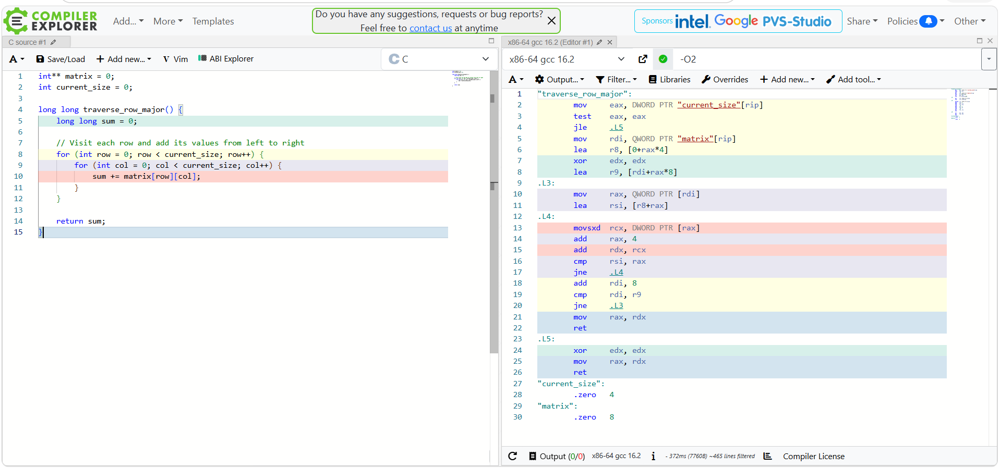
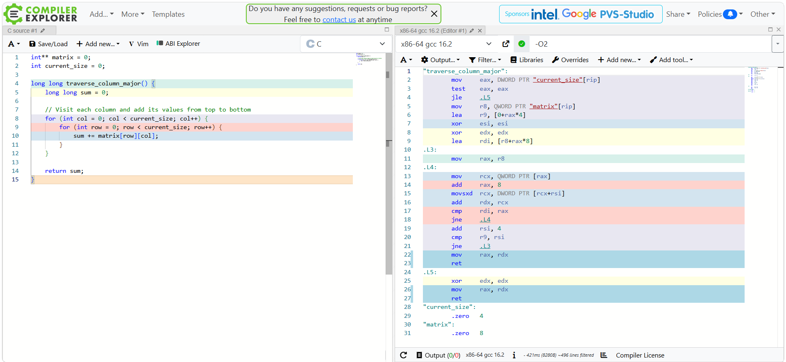

# Assignment 8: Cache Behavior Lab
## Performance and Hardware Analysis

### Section 1: Performance Measurements

I compiled and ran the Cache Behavior Lab using GCC 10.3.0 on Windows without specifying an optimization flag. Both traversal functions produced the same sums for all four matrix sizes.

| Matrix Size | Row-Major (ms) | Column-Major (ms) | Ratio (Col/Row) |
|---|---:|---:|---:|
| 1000 x 1000 | 1.00 | 7.00 | 7.00x |
| 2000 x 2000 | 9.00 | 38.00 | 4.22x |
| 4000 x 4000 | 36.00 | 177.00 | 4.92x |
| 8000 x 8000 | 209.00 | 581.00 | 2.78x |

**Performance Analysis**

The results show that row-major traversal was consistently faster than column-major traversal. The largest measured ratio was 7.00x for the 1000 x 1000 matrix, while the 8000 x 8000 matrix had a ratio of 2.78x. Both functions performed the same calculations and returned identical sums, so the difference was not caused by processing fewer elements. These results are consistent with the effect of memory access patterns on CPU cache performance.

**Ratio Calculation**

Column-Major Time / Row-Major Time = Performance Ratio

Example (4000 x 4000):
177.00 / 36.00 = 4.92x

### Section 2: Optimization Level Comparison

I tested the program using GCC 10.3.0 with three optimization levels: -O0, -O2, and -O3. Each version was tested using the same four matrix sizes to compare the execution times.

| Optimization | Matrix Size | Row-Major (ms) | Column-Major (ms) | Ratio (Col/Row) |
|---|---|---:|---:|---:|
| -O0 | 1000 x 1000 | 7.00 | 9.00 | 1.29x |
| -O0 | 2000 x 2000 | 16.00 | 12.00 | 0.75x |
| -O0 | 4000 x 4000 | 34.00 | 106.00 | 3.12x |
| -O0 | 8000 x 8000 | 145.00 | 771.00 | 5.32x |
| -O2 | 1000 x 1000 | 1.00 | 2.00 | 2.00x |
| -O2 | 2000 x 2000 | 4.00 | 34.00 | 8.50x |
| -O2 | 4000 x 4000 | 4.00 | 128.00 | 32.00x |
| -O2 | 8000 x 8000 | 29.00 | 1101.00 | 37.97x |
| -O3 | 1000 x 1000 | 1.00 | 3.00 | 3.00x |
| -O3 | 2000 x 2000 | 3.00 | 11.00 | 3.67x |
| -O3 | 4000 x 4000 | 5.00 | 134.00 | 26.80x |
| -O3 | 8000 x 8000 | 27.00 | 717.00 | 26.56x |

**Optimization Analysis**

The results show that compiler optimization improved row-major performance, especially for larger matrices. However, column-major performance varied across optimization levels. For example, with the 8000 x 8000 matrix, row-major traversal improved from 145 ms at -O0 to 27 ms at -O3.

**Does -O3 eliminate the performance gap?**

No, -O3 did not eliminate the performance gap between the two methods. At the largest matrix size, column-major traversal was still 26.56 times slower because its access pattern requires larger jumps between memory locations. Compiler optimization can improve how the instructions execute, but it does not guarantee that the program's memory access order will become more cache-friendly.

**Measurement Note**

These results came from one run at each optimization level. Some smaller tests showed inconsistent timing, including the 2000 x 2000 test at -O0, where column-major was faster. Timer resolution, caching, and other system activity may affect individual measurements, so the larger tests provide a clearer indication of the performance difference.

### Section 3: Assembly Analysis

I used Compiler Explorer with x86-64 GCC 16.2 and the -O2 optimization setting to compare the assembly generated for both traversal functions. Both functions perform the same calculation, but the way they access the matrix is different.

**Row-Major Assembly**

The row-major function uses instructions such as `mov`, `movsxd`, `add`, `cmp`, and `jne`. One important instruction is `add rax, 4`, which moves the pointer forward by four bytes to access the next integer in the same row. Since the values are stored next to each other, this allows the CPU to use cached data efficiently.

**Column-Major Assembly**

The column-major function uses many of the same instructions. However, its inner loop accesses different rows rather than moving through consecutive integers. The assembly includes `mov rcx, QWORD PTR [rax]` to retrieve a row pointer and `movsxd rcx, DWORD PTR [rcx+rsi]` to read an integer from that row. This involves additional pointer access and a less cache-friendly memory pattern.

**Assembly Comparison**

The two functions generate similar types of assembly instructions, including data movement, arithmetic, comparisons, and conditional jumps. However, the order of memory accesses is different. Row-major traversal reads consecutive integers, while column-major traversal repeatedly moves between rows.

This helps explain why the performance difference is so large even though both functions perform the same calculation. Compiler optimization changes how instructions are executed, but the memory access pattern remains important. The performance gap is primarily associated with cache and memory behavior rather than a major difference in the overall computation.

**Instruction Categories**

| Instruction | Category | Purpose |
|---|---|---|
| mov | Data movement | Transfers data between registers or memory |
| movsxd | Data movement | Loads and sign-extends a value |
| add | Arithmetic | Adds values or updates an address |
| lea | Address calculation | Calculates an address without reading memory |
| xor | Logical operation | Performs bitwise XOR, also used to clear registers |
| cmp | Comparison | Compares values for loop conditions |
| test | Logical operation | Checks values by setting condition flags |
| jne / jle | Control flow | Changes execution based on conditions |
| ret | Control flow | Returns from a function |

**RISC vs. CISC**

The assembly shown in Compiler Explorer uses the x86-64 instruction set, which is classified as CISC (Complex Instruction Set Computer). CISC instructions can perform relatively complex operations and may access memory directly. RISC (Reduced Instruction Set Computer) typically uses simpler instructions and a load/store approach where memory access is handled by dedicated instructions.

RISC designs often use regular instruction formats, which can simplify decoding, while CISC designs can express some operations using fewer instructions. Neither architecture automatically guarantees better performance because CPU implementation, compiler optimization, and memory behavior also matter.

In this experiment, the generated x86-64 instructions show that efficient memory access is important even when the compiler optimizes both functions.

**Compiler Note:** The assembly screenshots were generated using GCC 16.2, while the performance measurements were collected locally using GCC 10.3.0. The screenshots demonstrate the traversal patterns, but the generated instructions may differ slightly between compiler versions.

### Section 4: Cache Behavior Explanation

The biggest difference between row-major and column-major traversal is the order in which each function reads memory. In C, a regular two-dimensional array is stored in row-major order, meaning the elements in one row are placed next to each other before the next row begins. Our starter program uses `int** matrix` and allocates each row separately with `malloc()`, so the entire matrix is not guaranteed to be one continuous block. However, the integers within each row are still stored next to each other. Row-major traversal takes advantage of this by moving through all columns in a row before moving to another row. Column-major traversal does the opposite, reading one element from each row before moving to the next column.

The CPU uses cache memory to avoid repeatedly waiting for slower RAM. When the processor requests an integer, it typically loads a cache line containing that value and nearby data. With a common 64-byte cache line and 4-byte integers, one cache line can hold 16 consecutive integers. During row-major traversal, several of the next values are likely to already be in the cache. This improves spatial locality because the program uses data that was loaded together. The CPU's prefetcher can also recognize sequential memory access and load upcoming data before it is needed. This helps explain why row-major traversal was consistently faster in my larger matrix tests.

Column-major traversal causes larger jumps between memory locations. Instead of accessing the next integer in the same row, the program moves to another row and reads a value at the same column position. With larger matrices, these accesses are likely to involve different cache lines, causing more cache misses and additional memory access. Data loaded from one row may also be removed from the cache before the program returns to it. Both methods still have O(N²) time complexity and produce identical sums, but their memory access patterns affect their actual performance. The compiler can optimize instructions, loops, and calculations, but it cannot always safely rearrange memory accesses without potentially changing program behavior. My results showed that even with -O3 optimization, row-major traversal took 27 ms compared to 717 ms for column-major on the 8000 x 8000 matrix. This demonstrates why cache-friendly programming matters beyond algorithmic complexity.

**Connection to My Final Project**

For my Weather Sensor Monitoring and Anomaly Detection System, I plan to compare a linked-list implementation with an optimized array of sensor readings. The linked list requires following pointers between separately allocated readings, which can reduce cache efficiency. My optimized version will store temperature and humidity together in a contiguous array of structures and process readings sequentially when calculating statistics and checking for anomalies. I will compare performance across 10,000, 100,000, and 1,000,000 readings to determine whether improving memory access makes the system faster without changing its results.